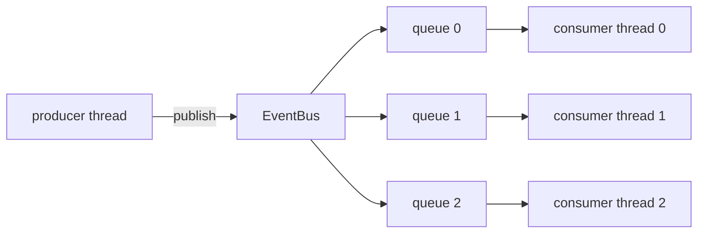

# ZenithBus

Here's the deal: the default way to pass data between threads is a mutex plus
a queue. That works, but it has jitter — lock contention, priority inversion,
syscall wakeups. If you're building something latency-sensitive (telemetry,
market data, robotics) that jitter is your tail latency.

The trick ZenithBus uses: if you *know* each queue has exactly one writer and
one reader, you don't need mutual exclusion at all. Two atomic counters and
the C++ memory model are enough. One producer broadcasts to N subscribers;
each subscriber gets its own single-producer/single-consumer ring buffer.



## Try it

```bash
make test     # build + run everything, including a 10M-message stress test
make bench    # latency + throughput, including real 2-thread ping-pong
make viz      # serve the live WASM visualizer at localhost:8469
```

Needs CMake 3.22+ and GCC 12+ or Clang 15+. Test dependencies download
themselves; the library itself needs nothing but `<atomic>`.

## Using it

```cpp
#include "zenith/event_bus.hpp"
#include <fmt/core.h>

struct Telemetry { uint32_t id; float speed; float steer; };

zenith::EventBus<Telemetry, 1024> bus;      // capacity: power of two, ≥ 2
auto sub = bus.subscribe();                 // once, at setup

std::jthread reader([&](std::stop_token st) {
    while (!st.stop_requested())
        bus.drain(sub, [](const Telemetry& t) {
            fmt::print("vehicle {} at {} m/s\n", t.id, t.speed);
        });
});

bus.publish({42, 12.5f, -0.05f});           // non-blocking, zero allocation
```

Two catches worth knowing:

- `publish()` returns `false` if any subscriber's queue is full — that
  subscriber drops the event *while the others still got it*. Don't retry the
  same event or you'll double-deliver. Want guaranteed delivery? Use
  `publish_wait()` — it spins until everyone accepts (and will spin forever
  if a subscriber dies, so pick your poison).
- Payloads must be plain structs — trivially copyable, standard layout.
  `std::string` won't compile, which is the point.

## Why it's fast

Producer and consumer each own one counter (`tail_` / `head_`), each on its
own 64-byte cache line so the cores never fight over the same line. Each side
keeps a local cached copy of the peer's counter and only does the real atomic
load when the queue *looks* empty or full — so the hot path is basically just
local arithmetic. Payload writes are ordered by a release-store on the index;
the consumer pairs it with an acquire-load. On x86-64 all of that compiles to
plain `mov`. No `lock`, no fences, no CAS retry loops anywhere.

Measured on a loaded laptop (Apple M-series, Release build):

| benchmark | result |
|---|---|
| push+pop, same thread | ~5.4 ns |
| 2 threads, ping-pong round trip | ~50 ns median, ~150 ns p99 |
| 2 threads, sustained throughput | ~55 M msg/s |
| fan-out publish to 8 subscribers | ~19.5 ns/publish |
| same code, no `alignas(64)` | 6–30% less throughput — false sharing is real |

Your numbers will differ; run `make bench`. There's also a `perf stat` CI job
counting actual L1 misses on padded vs unpadded builds.

## The visualizer

`web/` is a zero-dependency static site — no npm, no build step, plain HTML +
ES modules. It runs the *actual* headers compiled to WebAssembly, and the
queue/bus views are driven by real worker threads hammering the real objects
— the indices you see moving are live atomic state, not an animation. The
cache-line view is a conceptual diagram (coherence state is unobservable from
software, and it says that on the page).

Live at [zenith-bus.vercel.app](https://zenith-bus.vercel.app). Locally:
`make viz` — `serve.py` adds the COOP/COEP headers SharedArrayBuffer needs,
and `vercel.json` does the same on deploy.

## Deeper reading

Full docs live in the [GitHub wiki](https://github.com/unnobatroo/zenith-bus/wiki):
[API reference](https://github.com/unnobatroo/zenith-bus/wiki/API-Reference) ·
[how the memory model works](https://github.com/unnobatroo/zenith-bus/wiki/Architecture-and-Memory-Model) ·
[benchmarks](https://github.com/unnobatroo/zenith-bus/wiki/Benchmarking-and-Performance) ·
[drop it in your project](https://github.com/unnobatroo/zenith-bus/wiki/Integration-Guide)

GPL-3.0. PRs welcome — see CONTRIBUTING.md.
