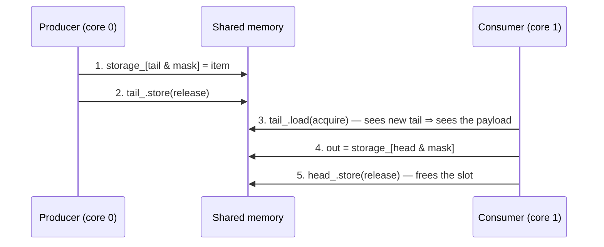

# Architecture and Memory Model

## The queue in one paragraph

`SPSCQueue` is a fixed-size ring buffer with two counters. `tail_` says where
the producer writes next, `head_` says where the consumer reads next. The
slot is `counter & (Capacity - 1)` — cheap bitmask math, which is why
capacity must be a power of two. The counters never wrap; they count up
forever and the mask maps them onto slots. `tail - head` is how many items
are in the queue. That's the whole data structure.

## Why there's no lock

A lock exists to stop two threads writing the same thing. Here each counter
has exactly one writer: the producer writes `tail_`, the consumer writes
`head_`, and each only *reads* the other's. No write-write conflict means no
mutex — and no CAS retry loop either, just loads and stores.

## The ordering, step by step

```cpp
// producer
storage_[tail & mask] = item;                        // 1. write data
tail_.store(tail + 1, std::memory_order_release);    // 2. publish it

// consumer
tail = tail_.load(std::memory_order_acquire);        // 3. observe index
out  = storage_[head & mask];                        // 4. read data
head_.store(head + 1, std::memory_order_release);    // 5. free the slot
```



Here's the rule that makes it correct: a release store promises that
everything the thread wrote *before* it is visible to anyone who
acquire-loads the stored value. So if the consumer sees the new `tail_`, it's
guaranteed to see the payload too — never the index without the data. Step 5
is the mirror image for freeing the slot.

What does that cost at runtime? On x86-64, nothing — acquire/release atomics
compile to plain `mov` because the hardware's memory model (TSO) already
gives you that ordering. On ARM64 you get real `ldapr`/`stlr` instructions —
you can see the ordering in the assembly, which is neat. Either way: zero
locks, zero fences, zero compare-exchange.

## Cache lines, aka why `alignas(64)` matters

Both counters get written constantly — by different threads, on different
cores. Cores don't share bytes; they share *cache lines* (64 bytes). If
`head_` and `tail_` sat on the same line, every index write would invalidate
the other core's copy and the line would ping-pong between cores on every
single operation. That's false sharing, and it's the classic way to make a
"lock-free" queue slow.

`ZENITH_CACHELINE` (which is just `alignas(64)`) puts each counter on its own
line. Want proof it's not cargo cult? Build `bench_event_bus_nopad`
(`-DZENITH_NO_CACHELINE_PAD`) and compare — on the dev machine it loses 6–30%
throughput depending on how the OS places the threads, and the
`perf-false-sharing` CI job counts the actual L1 misses.

## The cached peer indices

Here's the subtle part. To answer "is the queue full?" the producer needs
`head_` — an atomic living on a cache line owned by the other core. Loading
it on every push is cross-core traffic on the hot path. Instead the producer
keeps `cached_head_`, a plain non-atomic copy, and only does the real acquire
load when the cached copy says the queue might be full. Almost every push
skips the load entirely. The consumer does the same with `cached_tail_` for
the empty check. The threads only actually talk at the boundaries: nearly
full, nearly empty.

## The bus

`EventBus<T, Capacity, MaxSubscribers>` is `std::array<SPSCQueue, MaxSubs>`
plus an atomic subscriber count. `subscribe()` grabs a slot with a
compare-exchange loop — needed so a racing `publish()` can never see a count
that's out of bounds — and hands back the queue index as your handle.

`publish()` walks the active queues and `try_push`es into each. If queue 2 is
full, queues 0 and 1 still got the event and you get `false` back — partial
delivery is real, and retrying the same event would double-deliver to the
queues that accepted it. If every subscriber must get every event, use
`publish_wait()` — it spins until they all accept, which means it can also
spin forever if a subscriber goes away. Honest trade-off, pick deliberately.
