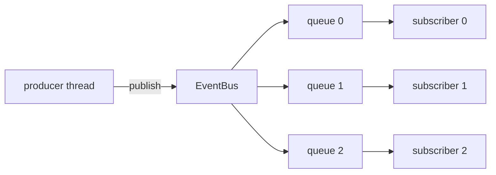

# ZenithBus

A header-only C++20 library for moving events between threads with no locks
and no allocations on the hot path. One producer, many subscribers, each with
a private SPSC ring buffer.

## Why it exists

Mutex-based queues have jitter: lock contention, priority inversion, syscall
wakeups. If your threads have fixed roles (one writes, one reads each queue),
you don't need mutual exclusion at all — two atomic indices and the C++
memory model are enough. ZenithBus packages that pattern so you don't
hand-roll atomics.

## The three rules

1. **Zero allocation on dispatch.** Queues are preallocated `std::array`s
   inside the bus. `publish()`/`poll()`/`drain()` never touch the heap.
2. **Payloads are plain structs.** `TriviallyRelocatable` = trivially
   copyable + standard layout. Slots are raw storage.
3. **One writer, one reader per queue.** That's what makes it lock-free. The
   bus is the only producer; each subscriber thread is the only reader of its
   queue.

## Numbers (M-series laptop, `make bench`)

- push+pop round trip, same thread: ~5.5 ns
- two threads, ping-pong round trip: ~50 ns median, ~200 ns p99
- two threads, sustained: ~53 M messages/sec
- fan-out publish to 8 subscribers: ~17.5 ns per publish

## Next

- [[Architecture and Memory Model]] — why it works
- [[API Reference]] — every function
- [[Integration Guide]] — drop it into your project
- [[Benchmarking and Performance]] — reproduce the numbers

## Also see

`web/` — an interactive visualizer running these exact headers in the
browser via WebAssembly, with real worker threads moving the indices.
