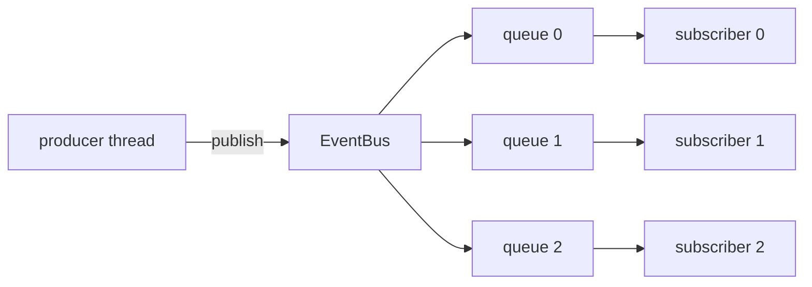

# ZenithBus

A header-only C++20 library for moving events between threads without locks.

The short version: when you know each queue has exactly one writer and one
reader, you don't need a mutex. Two atomic counters and correct memory
ordering are enough — and they're a lot faster.

## Why it exists

Mutex-based queues have jitter: lock contention, priority inversion, syscall
wakeups. In latency-sensitive pipelines that jitter becomes your tail
latency. ZenithBus packages the SPSC ring-buffer pattern — the same design
folly and moodycamel use — so you don't hand-roll atomics and get them wrong.

## Three rules to remember

1. **Nothing allocates on dispatch.** Queues are `std::array`s inside the
   bus, allocated once at construction. The hot path never touches the heap.
2. **Payloads are plain structs.** `TriviallyRelocatable` = trivially
   copyable + standard layout. Slots are raw storage — nothing is constructed
   or destroyed per message.
3. **One writer, one reader per queue.** That's the whole trick. The bus is
   the only producer; each subscriber thread is the only reader of its queue.
   Break that rule and it's UB — that's the price of lock-free.

## Numbers (Release, M-series laptop — `make bench` for yours)

- push+pop, same thread: ~5.4 ns
- two threads, ping-pong round trip: ~50 ns median
- two threads, sustained: ~55 M messages/sec
- fan-out to 8 subscribers: ~19.5 ns per publish

## Keep reading

- [[Architecture and Memory Model]] — why it works
- [[API Reference]] — every function, every caveat
- [[Benchmarking and Performance]] — reproduce and verify the numbers
- [[Integration Guide]] — drop it into your project in 5 lines of CMake

Bonus: `web/` is an interactive visualizer that runs these exact headers in
the browser via WebAssembly — with real worker threads, not an animation.
[zenith-bus.vercel.app](https://zenith-bus.vercel.app)
